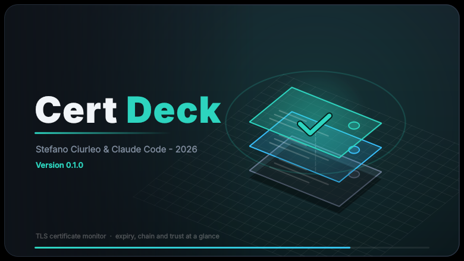
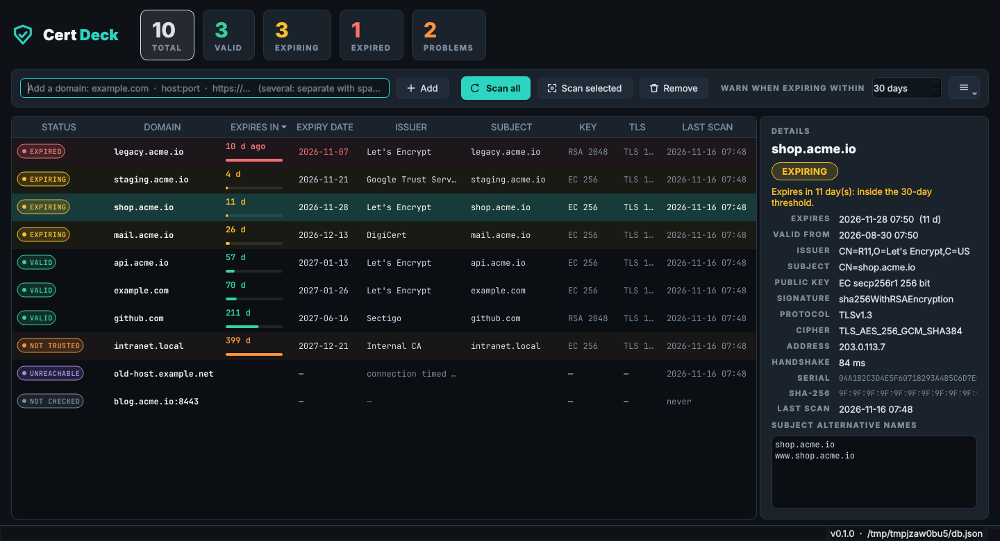

# Cert Deck

<p align="center"></p>

TLS certificate monitor with the same look and stack as CNC Deck: dark interface, animated splash screen,
Python 3 + Qt6 (PySide6) + `cryptography`.

<p align="center"></p>

## What it does

- A table of domains (`example.com`, `host:port` or a full URL; several at once separated by space/comma). The list is saved in a
  JSON file and is there again the next time you start the program.
- **Scan** connects to each endpoint, validates the chain against the system CA store and reads the certificate.
- **Colours**: *valid* (green), *expiring* (amber, inside the threshold), *expired* (red), *not trusted* (orange: self-signed,
  unknown CA, hostname mismatch), *unreachable* (violet: DNS, timeout, refused, TLS error), *not checked* (grey).
- **One threshold for all certificates** (toolbar, in days). Changing it recolours the table immediately, without rescanning.
- Each row: status, days left with a bar, expiry date, issuer, subject, key type/size, TLS version, last scan.
  The details panel adds validity start, full issuer/subject, signature algorithm, cipher, IP address, handshake time,
  serial, SHA-256 fingerprint, all SANs, and flags such as self-signed / wildcard / hostname mismatch.
- The summary tiles at the top are filters: click *Expiring* to see only those rows, click again to go back.
- Scans run in parallel (12 threads) and never block the UI; results are saved when a scan finishes.
- Context menu: scan, copy domain / fingerprint, open in browser, remove. Import a list from a text file, export CSV.

## When does it scan?

Never in the background and never on a timer. The only automatic scan is **once, right after the splash screen at program start**
(can be switched off from the ☰ menu). Adding or importing domains does **not** scan them: press **Scan all**
(`F5` / `Ctrl+R`) or **Scan selected**.

## Database

`~/.local/share/certdeck/certdeck.json` (or `$XDG_DATA_HOME/certdeck/`, or the path in `$CERTDECK_DB`, or `certdeck --db FILE`):
domains, last results, threshold and window geometry. Written atomically; a corrupted file is renamed to `*.corrupt` instead of being overwritten.

## Installation (Ubuntu)

```bash
./install.sh            # venv in ~/.local/share/certdeck-app, "certdeck" launcher, menu entry
certdeck                # certdeck --no-splash to skip the 3 s splash (or CERTDECK_NO_SPLASH=1)
```

Without installing: `pip install -r requirements.txt && python3 -m certdeck`.

## Notes and limits

- Only the certificate presented by the server is inspected (leaf); the chain is validated but not listed.
- Validation uses the OS trust store of the machine running Cert Deck, so private CAs show as *not trusted* unless installed there.
- Revocation (OCSP/CRL) is not checked.
- Only direct TLS (HTTPS, IMAPS, SMTPS…) is supported; STARTTLS ports are not.
- Behind a proxy that intercepts HTTPS you will see the proxy's certificate.

## Development

```bash
pip install -e .[dev]
python -m pytest              # URL parsing, scanner against local TLS servers (valid/expired/mismatch/refused), database, offscreen UI
python docs/make_screenshots.py
```
